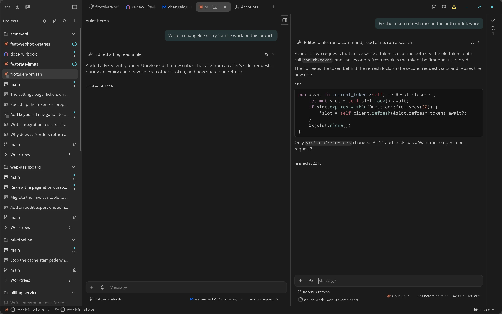
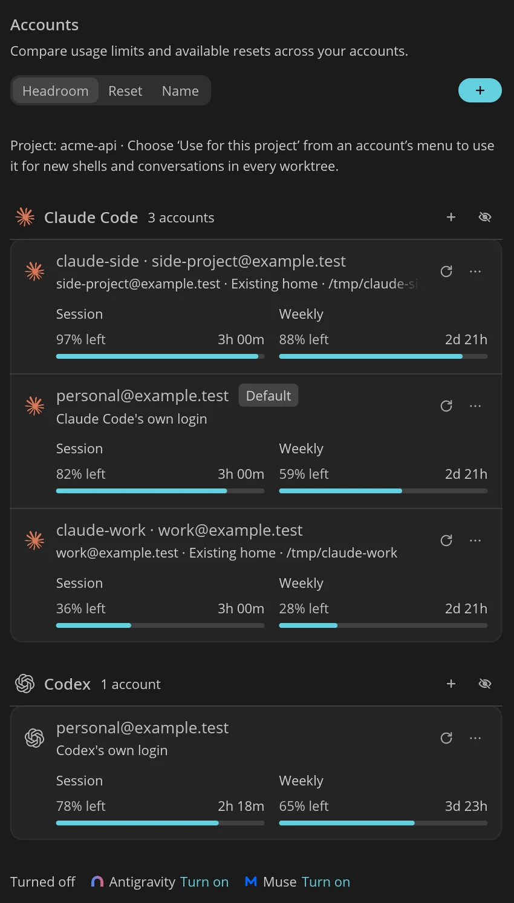
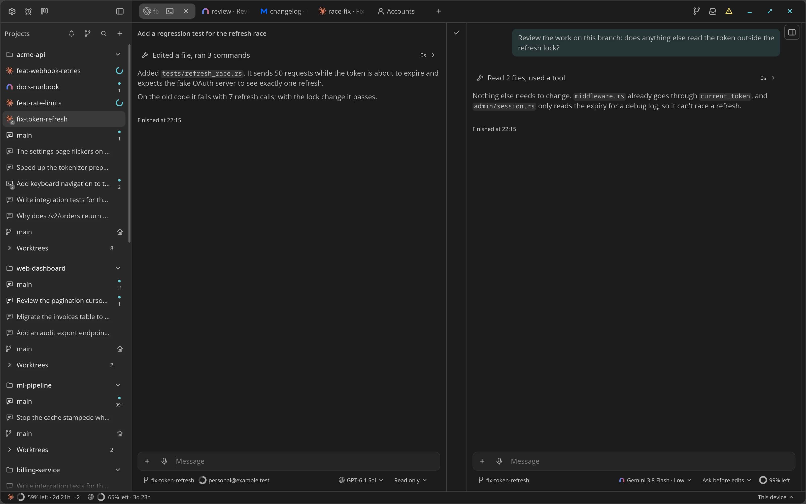
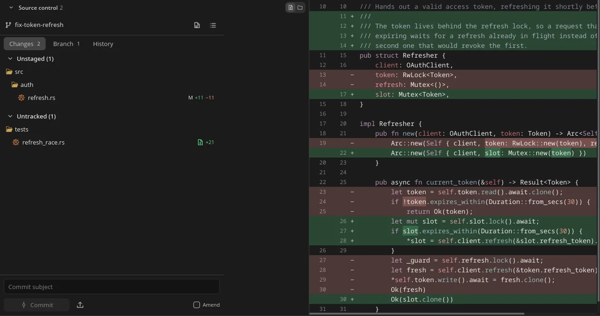
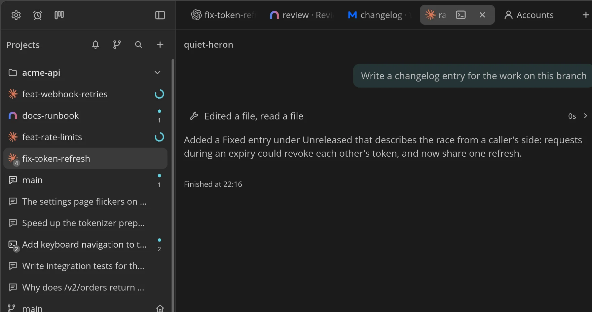

<p align="center">
  
</p>

<h1 align="center">cagents</h1>

<p align="center">A native Linux workspace for coding agents.</p>

<p align="center">
  <a href="https://carsonburke.github.io/cagents/">Website</a> ·
  <a href="https://github.com/CarsonBurke/cagents/releases/latest">Download</a> ·
  <a href="docs/user-guide.md">User guide</a>
</p>

> [!NOTE]
> This product is in beta. Expect bugs.



Sign in to as many Claude Code and Codex accounts as you have and run them side
by side, each with its own allowance. Keep Claude Code, Codex, Antigravity,
Muse and Oh My Pi in one native app, across repositories and Git worktrees,
with each agent's conversation, terminals, files, diffs and pull requests
together.

A per-user daemon owns your terminals and conversations. Close the window or
restart the UI while your agents keep working.

## Work with your agents

- **Several accounts per provider.** Add each Claude Code and Codex login, see
  how much of every allowance is left, and choose an account per conversation
  or let Automatic move to another plan when one runs out.
- **Terminal or native chat.** Switch a supported agent session between a real
  terminal and a native chat view of the same conversation.
- **Parallel worktrees.** Create a worktree from a branch name or Linear issue.
  See which agents are working, waiting, or have unread output.
- **Review in place.** Read diffs, stage changes, commit, browse branch history,
  and review pull requests with GitHub's viewed marks kept in sync.
- **Keyboard navigation.** Move through a horizontal strip of chats, terminals,
  editors, and browsers. Resize panes without leaving the keyboard.
- **Built-in editor.** Edit files and working-tree diffs with syntax highlighting,
  autosave, and optional language servers. The editor also ships as `ceditor`.
- **Browser panes.** Open pages in the optional Servo browser. Browserless
  builds open links in your system browser.
- **Remote workspaces.** Connect to another machine's daemon over SSH for
  terminals, native chats, files, Git, and worktrees. See [device windows](docs/devices.md).
- **CLI automation.** Control projects, terminals, and channels with text or JSON
  output. [Submit prompts and read structured results](docs/agent-execution.md)
  without an open window, or let sessions message one another. Use
  `cagents linear` to work with tickets from the command line.
- **From your phone.** The [Android app](mobile/README.md) follows your agents
  over SSH: see what needs you, read conversations as they stream, answer
  approvals and questions, and send, steer or stop a turn.

| | |
| --- | --- |
|  |  |
| Every account and its allowance | Different providers' agents side by side |
|  |  |
| Review the diff and commit in place | A worktree per task, with each agent's status |

## Install

cagents runs on **Linux x86_64 with Wayland**, glibc 2.35 or newer, and Git 2.36
or newer. The installer downloads releases with `curl`; no GitHub account is
needed.

Follow the [installation guide](docs/installation.md#install-with-the-verified-installer)
for the checksum-verified installer. It installs as your user without root.
You can also download full or browserless Debian packages and portable archives
from [Releases](https://github.com/CarsonBurke/cagents/releases).

Install the agent CLIs you want to use and sign in with your own accounts.

## Your first session

Launch **cagents** from your application menu, or run:

```sh
cagents ui
```

Add a repository in **Projects**, select a worktree, and press `Ctrl+Shift+T`
to open a terminal. Start your agent there, or choose **New tab → New thread**
for a native chat.

Choose **New tab → Resume conversation** to reopen a saved chat, including
conversations from configured provider history. Move between panes with
`Ctrl+PageUp` and `Ctrl+PageDown`; resize the focused pane with `Alt+R`.
The [user guide](docs/user-guide.md#navigation) covers the rest of the workspace
and its shortcuts.

To inspect the daemon and its terminals:

```sh
cagents daemon status
cagents --json terminal list
cagents --help
```

## Build from source

You need [mise](https://mise.jdx.dev/getting-started.html),
[rustup](https://rustup.rs/), and the
[native build dependencies](docs/development.md#prerequisites). `mise run setup`
installs the pinned Zig 0.15.2 with mise and Rust 1.93 with rustup.

```sh
git clone https://github.com/CarsonBurke/cagents.git
cd cagents
mise trust
mise run setup    # install the toolchains and report anything missing
mise run dev      # build and run the browserless development UI
```

`mise run dev` builds the matched CLI, UI, and daemon separately and uses an
isolated development instance that can run beside an installed copy.
`mise run dev:browser` includes the embedded Servo browser.

`mise tasks` lists the checks, tests, formatting, and packaging tasks. See
[development](docs/development.md#tasks) for what each does, and for runner
options.

## Documentation

- [Installation](docs/installation.md): packages, updates, and uninstalling
- [User guide](docs/user-guide.md): workspace, chat, review, editor, and shortcuts
- [Configuration](docs/configuration.md): settings and data locations
- [Device windows](docs/devices.md): work on remote machines over SSH
- [Agent execution](docs/agent-execution.md): hosted prompts, results, and messaging
- [Android app](mobile/README.md): follow and steer agents from your phone
- [Mobile API](docs/mobile-api.md): the protocol the phone app speaks
- [Daemon and upgrades](docs/daemon.md): session ownership and upgrade behavior
- [Development](docs/development.md): building, running, and testing
- [Performance](docs/performance.md): workloads and reference results
- [Releasing](docs/releasing.md): building and publishing releases

## License

[MIT](LICENSE).
