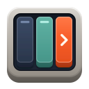
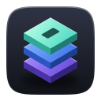

# Brand marks

## Application icons

| cagents | ceditor |
| :-: | :-: |
|  |  |

Both icons share the same tactile 2.5D machined obsidian switchboard chassis
following GNOME Circle / Libadwaita orthographic proportions, with modules
seated directly on the deck body.

- **cagents** houses three chunky vertical workspace modules — deep slate-navy,
  cool teal-mint, and a focal coral-orange active lane etched with a crisp `>`
  prompt chevron — communicating parallel coding agents with one workspace in
  focus.
- **ceditor** uses the same obsidian chassis with a slim cool teal-mint gutter
  rail beside a wide deep slate-navy editor pane, chunky syntax bars, a bright
  active line, and a focal coral-orange caret.

At tray and task bar sizes (16-22 px) both marks remain crisp and distinct:
three equal coloured vertical lanes vs. a slim teal gutter beside a dark editor
pane with an active line and coral caret.

## Construction

- Chassis: 108 × 101 px rounded rectangle (`rx = 18`) with an 8 px machined
  gunmetal 2.5D bottom lip (`#1A212E` → `#2D384D` → `#1A212E`) and satin
  obsidian face (`#384358` → `#222A3B`) framed by a subtle top and chamfer rim
  light.
- Modules: 2.5D tactile keycaps (`rx = 7.5–8`) seated directly on the chassis
  with subtle top rim highlights and grounded bottom edges.
- Palette: deep slate-navy (`#3F4F6B` → `#2B374D`), cool teal-mint
  (`#64B8AA` → `#459689`), and focal coral-orange (`#FF7A48` → `#E34C1A`).

## Files

- `packaging/dev.cagents.Cagents.svg` is the source of truth for the cagents
  icon. `packaging/dev.cagents.Cagents.png` is its 128 px raster, embedded as
  the window and tray icon; regenerate it from the SVG whenever the SVG
  changes.
- `packaging/io.github.cagents.ceditor.svg` is the source of truth for the
  ceditor icon, embedded in the UI directly. Its 128 px raster,
  `packaging/io.github.cagents.ceditor.png`, is embedded as the native editor
  window icon; regenerate it whenever the SVG changes.

From the repository root, regenerate the PNG with librsvg's `rsvg-convert`:

```sh
rsvg-convert --width 128 --height 128 \
  --output packaging/dev.cagents.Cagents.png packaging/dev.cagents.Cagents.svg
rsvg-convert --width 128 --height 128 \
  --output packaging/io.github.cagents.ceditor.png packaging/io.github.cagents.ceditor.svg
```

Keep the transparent background; the window and tray loaders expect a 128×128
RGBA PNG.

## Alternates

Kept for reference; not shipped.

| Cascade | Orbit | Stack |
| :-: | :-: | :-: |
|  |  |  |
| A prompt running ahead of its own trail. The boldest silhouette in a dock, but reads as "fast forward". | Agents orbiting a core. Polished, but says "space app". | Layered sessions. Reads as storage or a design tool. |
