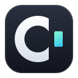
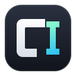
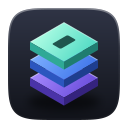

# Brand marks

## Application icons

| cagents | ceditor |
| :-: | :-: |
|  |  |

Both icons are the same object: a dark machined bezel around a glass screen.

- **cagents** shows a split terminal with three panes, each with an agent
  at its prompt and its own coloured cursor. It is what the app is for:
  many agents working side by side.
- **ceditor** shows one editor pane: line gutter, syntax-coloured code, the
  current line lit, and an I-beam caret.

At tray and task bar sizes (16-22 px) the detail falls away and each icon
reduces to a dark tile with its coloured cursors, which keeps it
recognisable.

## Construction

- Tile: a superellipse (n = 5) inset 8 px on the 128 px grid.
- Bezel: vertical gradient `#565C6B` → `#2A2E37` → `#14161B`, with a rim
  light that fades from the top edge.
- Screen: 90 px square, radius 15, a radial glow `#15263A` → `#05070B` lit
  from the upper left, a recessed edge, and a faint diagonal glare.
- Agent colours: mint `#7CF5C8`, amber `#FFC46B`, lavender `#C3A6FF`. Each
  cursor has a solid light core over a blurred glow of its colour.

## Files

- `packaging/dev.cagents.Cagents.svg` is the source of truth for the cagents
  icon. `packaging/dev.cagents.Cagents.png` is its 128 px raster, embedded as
  the window and tray icon; regenerate it from the SVG whenever the SVG
  changes.
- `packaging/io.github.cagents.ceditor.svg` is the ceditor icon, embedded in
  the UI directly.

## Alternates

Kept for reference; not shipped.

| Cascade | Orbit | Stack |
| :-: | :-: | :-: |
|  |  |  |
| A prompt running ahead of its own trail. The boldest silhouette in a dock, but reads as "fast forward". | Agents orbiting a core. Polished, but says "space app". | Layered sessions. Reads as storage or a design tool. |
